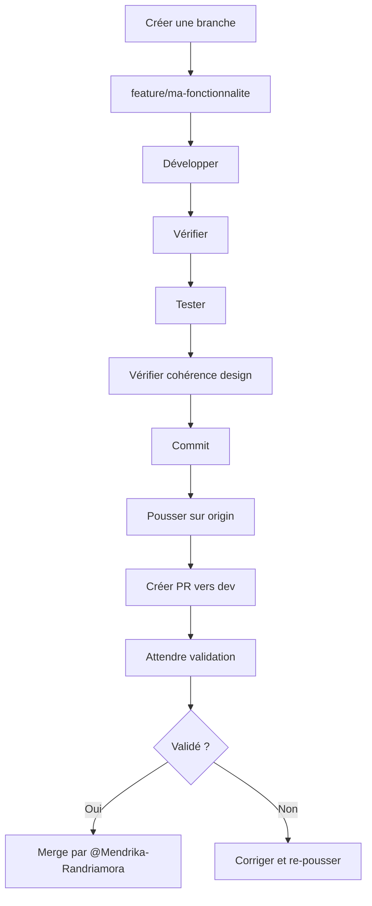

# Contributing - Plume

> ⚠️ **Lire attentivement avant de contribuer**

Ce document définit les règles strictes à suivre pour contribuer au projet **Plume**. Toute violation de ces règles entraînera le rejet des contributions.

---

## 🚫 A NE PAS FAIRE (Interdictions Absolues)

| Règle | Description | Conséquence |
|-------|-------------|-------------|
| **Pas de commit direct sur `main`** | Aucune modification ne doit être commité directement sur la branche `main` | Rejet immédiat, réversion forcée |
| **Pas de commit direct sur `dev`** | Aucune modification ne doit être commité directement sur la branche `dev` | Rejet immédiat, réversion forcée |
| **Pas de modification de `main`** | Aucune opération (merge, rebase, amend, etc.) ne doit être effectuée sur `main` | Rejet immédiat |
| **Pas de validation de PR** | Seul **@Mendrika-Randriamora** peut valider (merge) une Pull Request | La PR restera en attente |

> ⚠️ **Toute violation de ces interdictions sera sanctionnée par le rejet immédiat de la contribution et éventuellement par des mesures supplémentaires.**

---

## ✅ Règles de Développement

### 1. Pipeline de Développement Obligatoire

**TOUTE contribution doit suivre ce pipeline strict :**

```
Code → Vérifier → Tester → Vérifier la cohérence du design → Pull Request
```

#### Étapes détaillées :

1. **Code**
   - Écrire le code en suivant la structure du projet
   - Respecter les conventions de nommage existantes
   - Ajouter des commentaires si nécessaire (mais éviter les commentaires inutiles)

2. **Vérifier**
   - Vérifier la syntaxe (`npm run lint` ou équivalent)
   - Vérifier les types (TypeScript/Rust)
   - Vérifier que le code compile sans erreur

3. **Tester**
   - Exécuter les tests existants
   - Tester manuellement les fonctionnalités ajoutées/modifiées
   - Vérifier les cas limites et les erreurs potentielles

4. **Vérifier la cohérence du design**
   - Le code doit s'intégrer harmonieusement avec l'architecture existante
   - Respecter les patterns déjà en place
   - Ne pas introduire de nouvelles dépendances sans justification

5. **Pull Request**
   - Créer une PR vers la branche `dev` (jamais vers `main`)
   - La PR doit être claire et bien documentée
   - Attendre la validation de @Mendrika-Randriamora

---

### 2. Structure du Projet

**Respecter absolument la structure existante :**

```
src/
  core/                    # Socle partagé
    ipc.ts                # Communication IPC
    format.ts             # Fonctions de formatage
    settings/             # Gestion des paramètres
      store.ts
      theme.ts
      SettingsProvider.tsx
    layout/               # Composants de layout
      Sidebar.tsx
      nav.ts
    ui/                   # Composants UI partagés
  pages/                  # Pages de l'application
    registry.ts           # Registre des pages (ordre = ordre du menu)
    home/                 # Exemple de page
      index.ts            # Déclaration de la page
      HomePage.tsx        # Composant React
      api.ts              # Appels Rust
      types.ts            # Types TypeScript
      components/         # Composants spécifiques
    updates/
    clean/
    settings/
  styles/                # Styles globaux

src-tauri/src/
  main.rs                # Point d'entrée Tauri
  shared/                # Code Rust partagé
    mod.rs
    fsutil.rs            # Utilitaires filesystem
    scanner.rs           # Scanner de /home
  modules/               # Modules Rust (un par page)
    home/
      mod.rs
    updates/
      mod.rs
    clean/
      mod.rs
```

**Pour ajouter une nouvelle page :**
1. Créer un dossier dans `src/pages/<nom-page>/`
2. Créer un fichier `index.ts` exportant `page` (voir exemple existant)
3. Ajouter la page dans `src/pages/registry.ts`
4. Côté Rust : créer `src-tauri/src/modules/<nom_page>/mod.rs`
5. Enregistrer les commandes dans `src-tauri/src/main.rs`

---

### 3. Conventions de Code

#### TypeScript/React
- Utiliser TypeScript avec typage strict
- Composants React : nom en PascalCase (`NomComposant.tsx`)
- Fichiers utilitaires : nom en camelCase (`nomFonction.ts`)
- Types : nom en PascalCase (`TypeNom`)
- Interfaces : nom en PascalCase (`INom`)

#### Rust
- Suivre les conventions Rust (rustfmt)
- Noms de modules : snake_case
- Noms de fonctions : snake_case
- Noms de types : PascalCase
- Documenter avec `///` pour la documentation publique

#### Nommage des branches
- Format : `feature/<nom-fonctionnalite>` ou `fix/<nom-correction>`
- Exemples : `feature/ajout-page-monitoring`, `fix/correction-scanner`
- **Jamais** de branch nommé `main`, `dev`, `master`, etc.

---

### 4. Workflow Git



#### Commandes Git recommandées :
```bash
# Créer une nouvelle branche
git checkout -b feature/ma-fonctionnalite

# Commiter les changements
git add -A
git commit -m "feat: ajouter ma fonctionnalité"

# Pousser la branche
git push -u origin feature/ma-fonctionnalite

# Créer une PR (via GitHub UI ou gh CLI)
gh pr create --base dev --head feature/ma-fonctionnalite --title "feat: ajouter ma fonctionnalité"
```

---

### 5. Messages de Commit

Utiliser la convention [Conventional Commits](https://www.conventionalcommits.org/) :

- `feat:` - Ajout d'une nouvelle fonctionnalité
- `fix:` - Correction d'un bug
- `docs:` - Modification de la documentation
- `style:` - Changements de style (espaces, formatage, etc.)
- `refactor:` - Refactorisation de code
- `perf:` - Amélioration des performances
- `test:` - Ajout ou modification de tests
- `chore:` - Changements de configuration ou de dépendances

Exemples :
- `feat: ajouter page de monitoring CPU`
- `fix: corriger le scanner de fichiers temporaires`
- `docs: mettre à jour le README`

---

### 6. Pull Requests

**Exigences pour une PR :**

1. **Titre clair** : Utiliser le même format que les commits
2. **Description complète** :
   - Expliquer le but de la PR
   - Décrire les changements effectués
   - Mentionner les tests effectués
   - Ajouter des captures d'écran si UI modifiée
3. **Cibler `dev`** : La PR doit être vers `dev`, jamais vers `main`
4. **Code à jour** : La branche doit être synchronisée avec `dev`
5. **Pas de conflits** : Résoudre tous les conflits avant de soumettre

**Template de PR :**
```markdown
## Description

[Description claire de la PR]

## Changements
- [x] Ajout de ...
- [x] Modification de ...
- [x] Correction de ...

## Tests
- [x] Tests unitaires passés
- [x] Tests manuels effectués
- [x] Vérification de la cohérence du design

## Notes
[Autres informations pertinentes]
```

---

### 7. Revue de Code

**Processus :**
1. Le contributeur crée une PR vers `dev`
2. @Mendrika-Randriamora (ou autres mainteneurs désignés) revoit le code
3. Des commentaires peuvent être ajoutés pour demander des modifications
4. Le contributeur corrige et pousse les changements
5. @Mendrika-Randriamora valide et merge la PR

**Critères de validation :**
- [ ] Le code suit les conventions
- [ ] Le code est propre et maintenable
- [ ] Les tests passent
- [ ] La fonctionnalité est complète
- [ ] La documentation est mise à jour si nécessaire
- [ ] La cohérence du design est respectée

---

### 8. Gestion des Erreurs

**Si une PR est rejetée :**
1. Lire attentivement les commentaires
2. Corriger les problèmes mentionnés
3. Commiter les corrections avec un message clair
4. Pousser les changements (la PR se mettra à jour automatiquement)

**Si un commit est réverté :**
1. Comprendre pourquoi la réversion a eu lieu
2. Corriger le problème
3. Soumettre une nouvelle PR avec les corrections

---

## 📋 Checklist avant de soumettre

- [ ] J'ai lu et compris toutes les règles de ce document
- [ ] Mon code suit la structure du projet existante
- [ ] J'ai suivi le pipeline : Code → Vérifier → Tester → Vérifier design → PR
- [ ] Ma branche ne cible pas `main`
- [ ] Ma PR cible `dev`
- [ ] J'ai testé mes changements localement
- [ ] Tous les tests passent
- [ ] Mon code compile sans erreur
- [ ] J'ai utilisé des messages de commit clairs et conventionnels
- [ ] Ma PR a une description complète
- [ ] Je n'ai pas modifié `main` directement

---

## 🙋 Questions ?

Pour toute question concernant ces règles ou le processus de contribution, contacter **@Mendrika-Randriamora** avant de commencer le développement.

---

> ⚠️ **Rappel :** Le non-respect de ces règles entraînera le rejet systématique des contributions. Il n'y aura pas d'exceptions.
